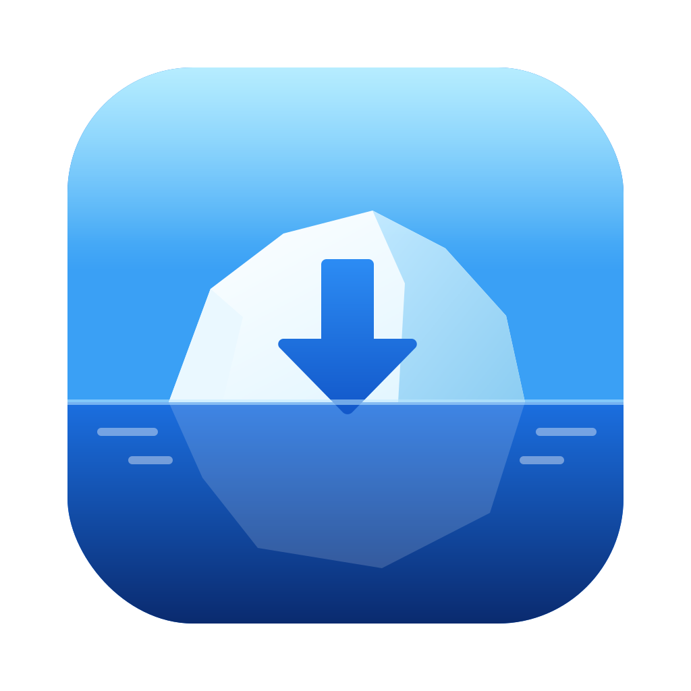
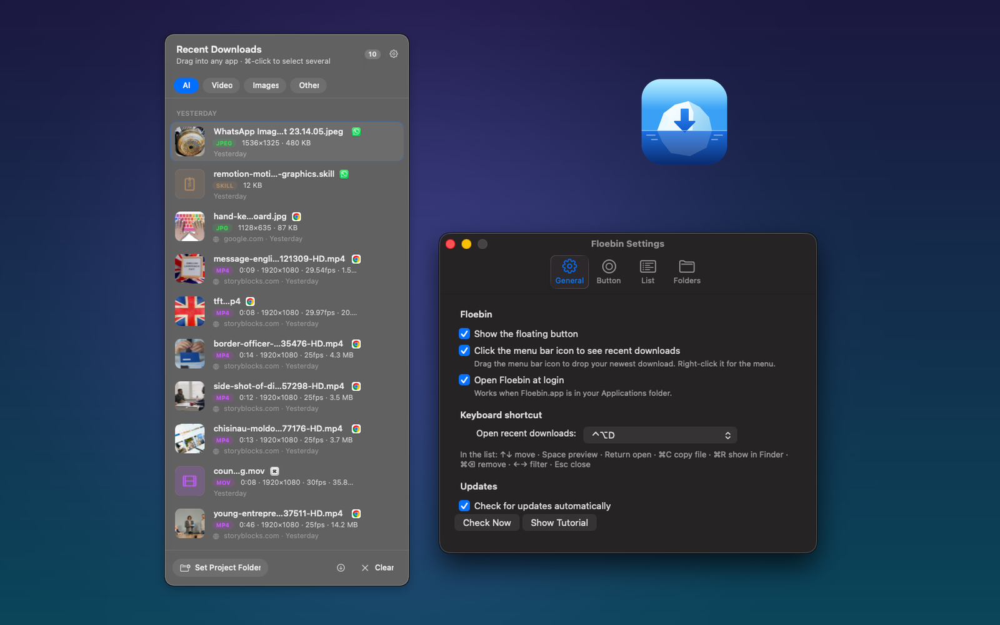
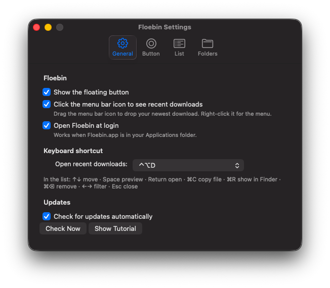
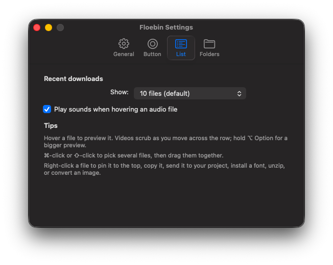
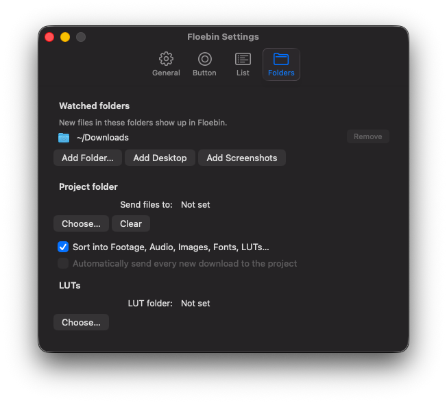

<p align="center">
  
</p>

<h1 align="center">Floebin</h1>

<p align="center">
  <b>Your downloads, one drag away.</b><br>
  A floating button for macOS that catches what you download in the browser so you can drag it straight into Premiere, Resolve, Final Cut, After Effects, Figma, Slack or anything else, even when that app is full-screen.
</p>

<p align="center">
  <a href="https://github.com/shahemtiaj/floebin/releases/latest"><b>⬇︎ Download the latest version</b></a>
  ·
  macOS 13 Ventura or later · Free
</p>

<p align="center">
  
</p>

---

## Why Floebin?

If you edit video or design, you know the routine: download a clip, sound effect, font or texture, leave your full-screen timeline, dig through Finder, drag it back. Floebin removes that whole trip.

```
Browser download  →  Floebin's floating button lights up  →  drag it straight into your app
```

The button floats above every app and every Space, including full-screen apps, so your downloads are always one drag away.

## Features

### 🫧 The floating button
- Floats above **every app and every desktop Space**, full-screen apps included.
- When a download finishes, it shows a **thumbnail of the new file and pulses**. A small spinner shows while something is still downloading.
- **Drag the button** to drop the file into any app. Floebin hands over a copy, so the original stays safe in Downloads.
- **Hold ⌥ Option and drag** to move the button anywhere. Its position is remembered and kept on screen.
- Three sizes (Small, Medium, Large), six quick positions and a **Lock** so it never moves by accident.
- Fades back when you're not using it, so it never gets in the way.

### 📋 Recent downloads list
Click the button (or press **⌃⌥D** anywhere) to open your recent downloads.
- Grouped into **Today**, **Yesterday** and **Earlier**; show 5, 10, 15, 20 or 30 files.
- Every row shows a thumbnail, file type badge, size, **media info** (duration · resolution · fps for video, duration · sample rate for audio, pixel size for images), the **website it came from** and the **browser icon** (Chrome, Safari, Arc, Brave, Edge, Firefox and more).
- **Drag any row** into an app, or **⌘-click / ⇧-click** several rows and drag them all together.
- **Filter chips**: All · Video · Audio · Image · Font · Other. They appear automatically when the list has more than one kind of file.
- **Pin to Top**: right-click a file to keep it in a **Pinned** section above everything else, so your go-to logo, LUT or music bed is always there.

<p align="center">
  
</p>
<p align="center"><sub>Thumbnails, file type, duration · resolution · fps, size, the website each file came from and the browser that downloaded it.</sub></p>

### 👀 Live previews
- **Hover a video** and it scrubs as you move the mouse across the row, like a timeline.
- **Hover audio** and it plays (you can turn this off).
- **Hover an image** to see it large.
- **Hold ⌥ Option** for a preview twice as big.

### ⌨️ Keyboard control
Press **⌃⌥D** from any app. The list opens at your mouse pointer, ready for the keyboard:

| Key | Action |
| --- | --- |
| ↑ ↓ | Move between files |
| Space | Preview |
| Return | Open |
| ⌘C | Copy the file (paste it into Finder or an app) |
| ⌘R | Show in Finder |
| ⌘⌫ | Remove from the list |
| ⌘A | Select all |
| ← → | Change filter |
| Esc | Close |

You can switch the shortcut to ⌃⌥Space, ⌥⇧D, ⌃⇧Space or ⌃⌥⌘V, or turn it off.

### 📁 Send to your project
- Pick a **project folder** once. Then hover a row and click 📁+, or right-click → **Send to “Project”**.
- Files are sorted automatically into **Footage, Audio, Images, Fonts, LUTs and Documents**.
- Turn on **Auto-Send** and every new download goes straight into your project.

### ⚡️ Smart actions (right-click)
- **Fonts** → Install Font
- **LUTs** (.cube, .3dl…) → Copy to your LUT folder
- **ZIP files** → Unzip
- **Images** → Convert to PNG or JPG
- Any file → Open Source Page / Copy Source Link (handy for licenses and credits), Copy File, Show in Finder

### 🗂 Watch more than Downloads
Settings → Folders lets you add **Desktop**, your **Screenshots** folder or **any folder**. New files there show up in Floebin too.

### 🧭 Menu bar mode
- Floebin also lives in the menu bar. A dot appears when a new download lands.
- Optionally **click the menu bar icon to open recent downloads**, and **drag the menu bar icon** to drop your newest file.
- Hide the floating button completely for a clean, menu-bar-only setup.

### ⚙️ Settings window (⌘,)
Everything in one place, in four tabs: **General** (button, menu bar, launch at login, shortcut, updates), **Button** (size, position, lock), **List** (how many files, audio on hover) and **Folders** (watched folders, project folder, LUT folder).

| General | Button |
| --- | --- |
|  |  |
| **List** | **Folders** |
|  |  |

The ⚙ button in the list also opens a quick settings menu:

<p align="center">
  
</p>

### 🔄 Automatic update checks
Floebin checks GitHub once a day and tells you when a new version is out. You can also check from the menu bar icon → **Check for Updates…**, or turn checks off in Settings → General.

### 👋 Friendly from the first launch
- A short, skippable **tour** shows new users the basics. Replay it any time from the menu.
- **VoiceOver** labels on the button, menu bar icon, rows and controls.
- No Dock icon, no clutter: Floebin stays out of your way.

## Install

1. Download **Floebin-x.y.z.dmg** from the [latest release](https://github.com/shahemtiaj/floebin/releases/latest).
2. Open it and drag **Floebin** into **Applications**.
3. First launch: **right-click Floebin → Open → Open**. Floebin isn't notarized by Apple yet, so macOS asks once.
4. Click **Allow** when macOS asks for access to your Downloads folder.
5. Optional: menu bar icon → **Launch at Login**.

## Build from source

Requires Swift 5.9+ (Xcode or the Command Line Tools: `xcode-select --install`).

```bash
git clone https://github.com/shahemtiaj/floebin.git
cd floebin
bash build.sh
open build/Floebin.app
```

`bash release.sh` builds the app and a DMG in `build/`.

### Signing

`build.sh` picks the best signature it can find:

1. **Developer ID Application** (paid Apple Developer account): needed for notarized releases.
2. **Floebin Local**: a free certificate you make once. macOS then remembers Floebin's Downloads permission across rebuilds.
3. **Ad-hoc**: works on this Mac only; macOS may ask for Downloads access again after each rebuild.

To make **Floebin Local** (one minute): open **Keychain Access** → menu **Keychain Access → Certificate Assistant → Create a Certificate…** → Name `Floebin Local`, Identity Type *Self Signed Root*, Certificate Type *Code Signing* → Create. Then run `bash build.sh` again.

## Releasing a new version

1. Bump `CFBundleShortVersionString` (e.g. `0.9.1`) and `CFBundleVersion` in `Resources/Info.plist`.
2. Run `bash release.sh`. You get `build/Floebin-0.9.1.dmg` (signed and notarized if a Developer ID is set up; see the notes in `release.sh`).
3. Publish a GitHub release tagged `v0.9.1` with the DMG attached.

Every installed copy of Floebin finds it through its update check.

## Project layout

```
Package.swift                         Swift package (no Xcode project needed)
Sources/Floebin/
  FloebinApp.swift                    Entry point (menu bar app, no Dock icon)
  AppDelegate.swift                   Floating panel, menus, watched folders, pins, settings glue
  DownloadWatcher.swift               Watches folders, ignores unfinished downloads
  FloeButtonView.swift                The round button: thumbnail, drag-out, pulse, spinner
  RecentListController.swift          Recent list: filters, pins, keyboard control, rows
  PreviewController.swift             Hover preview (video scrub, audio, ⌥ for large)
  MediaInfo.swift                     Duration / resolution / fps, source website and browser
  FileActions.swift                   File menus, send to project, fonts, LUTs, unzip, convert
  SettingsWindowController.swift      Settings window (⌘,)
  HotKey.swift                        Global keyboard shortcut
  UpdateChecker.swift                 GitHub release update checks
  StatusIconView.swift                Menu bar icon: click for recents, drag the newest file
  TutorialController.swift            First-launch tour
  AboutController.swift               About Floebin and credits
  Styles.swift / Thumbnails.swift     Shared UI pieces and Quick Look thumbnails
Resources/                            Info.plist and the app icon
build.sh / release.sh                 Build the app / build a DMG
```

## Credits

Floebin is designed and built by **Shah Emtiaj**.

- Website: [shahemtiaj.com](https://shahemtiaj.com)
- GitHub: [github.com/shahemtiaj](https://github.com/shahemtiaj)
- Facebook: [facebook.com/shahemtiaj](https://www.facebook.com/shahemtiaj/)
- X: [x.com/shahemtiaj](https://x.com/shahemtiaj)
